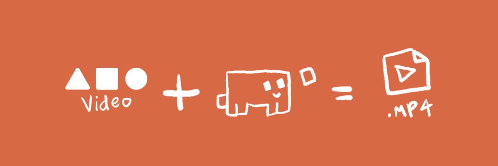

<p align="center">
  
</p>

<p align="center">
  
</p>

<h1 align="center">AIO-video</h1>

<p align="center">
  Arabic video editing with code, for Claude Code. GPU-accelerated, 60 fps, renders to drive D.
</p>

<p align="center">
  <a href="https://github.com/USERNAME/AIO-video/releases/latest/download/AIO-video.zip">
    
  </a>
</p>

---

## What it does

- **Talking-head reels** (9:16): Arabic captions timed to each word, keyword pops, motion graphics.
- **Motion graphics** from a script or idea, with an AI or your own voice.
- **Podcasts and interviews**: multi-camera cuts, long episodes into several reels.
- **Beat-synced montages** on a music track.
- **Thumbnails and reel covers**.
- **DaVinci Resolve** timelines.

## Requirements

- Windows 10 or 11
- Claude Code (desktop app or CLI)
- Node.js 18+ and Python 3.10+
- FFmpeg in your PATH
- Optional: an NVIDIA GPU (RTX series) for NVENC and CUDA. Without it the plugin falls back to the CPU.

## Installation

### Option 1: from a release (recommended)

1. Click the **Download** button above, or go to the Releases page and download `AIO-video.zip`.
2. Unzip it to a folder, for example `D:\AIO-video`.
3. Open Claude Code and run the plugin install command:

```bash
claude plugin install ./AIO-video
```

### Option 2: from the repository

```bash
git clone https://github.com/USERNAME/AIO-video.git
cd AIO-video
claude plugin install .
```

### Install the video engine dependencies

```bash
cd video-ad-editor
npm install
```

Then restart Claude Code.

## Usage

Open Claude Code in your project folder and describe what you want in plain language. Examples:

- "Make a 9:16 reel from this talking video with Arabic captions."
- "Turn this script into a motion graphics video with a voiceover."
- "Make a montage of these clips on this song, synced to the beat."
- "Make a thumbnail for this reel."

On the first run the onboarding page asks you to choose a style and upload your fonts.

## Styles

Styles are in `video-ad-editor/styles/`: `glow-talk` (default), `prof-amine`, `faceless-mg`, `classic`, `minimal`, `bold-kinetic`. Apply one with:

```bash
python video-ad-editor/scripts/apply_style.py <style-name>
```

## Output

Renders go to `D:\autoedit\renders\<project>` by default. Change `RENDER_ROOT` in `scripts/_gpu.js` if you use another drive.

## Credits and license

Based on `majed-video` (MIT). This fork is also MIT. See [LICENSE](LICENSE).
